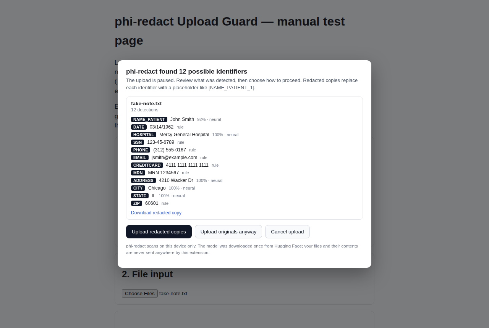

# phi-redact Upload Guard

A Chrome extension that scans files **locally, in your browser, before
you upload them**, warns you when they contain PII or PHI, and offers a
redacted copy — before anything leaves the device.

It is built on [phi-redact](https://huggingface.co/CDT5058/phi-redact),
a compact on-device redaction model, and reuses the inference contract
of the [phi-redact SDK](https://github.com/ctrimm/phi-redact-sdk)
(rules layer, BIOES decoding, merge policy, and placeholder scheme are
ports of the SDK's code; see `DECISION_LOG.md`).

## Demo

[](docs/demo.mp4)

A 12-second recording ([docs/demo.mp4](docs/demo.mp4)): a fake clinical
note is attached to a file input, the guard pauses the upload and lists
12 detected identifiers, and the page receives a redacted copy —
`fake-note.redacted.txt` with placeholders like `[NAME_PATIENT_1]` and
`[SSN_1]`. The one-time model download is not shown. Filmed on the
bundled test page (`test/upload-test.html`); all data is fake.

## What it does

When you start an upload — choosing files in a file input, dropping
files onto a page, or pasting files — the extension pauses the upload
and scans each file on-device:

| File type | How it is read |
| --- | --- |
| `.txt`, `.md`, `.csv`, other text | Read as text directly |
| `.pdf` | Text layer via pdf.js; scanned (image-only) PDFs fall back to OCR for the first pages |
| `.png`, `.jpg`, `.webp` | OCR via tesseract.js, keeping word bounding boxes |

Detection combines the phi-redact neural model (names, hospitals,
addresses, free-text PHI) with the SDK's deterministic rules layer
(checksum-gated cards, SSNs, IBANs, phones, emails, dates, MRNs, ...)
at the SDK's default threshold of 0.6.

If anything is found — or a file could not be fully scanned — a review
panel shows the detections per file and offers:

- **Upload redacted copies**: identifiers replaced with placeholders
  like `[NAME_PATIENT_1]` (text and PDFs-as-text), or black boxes over
  the detected words (images).
- **Upload originals anyway**: the upload proceeds untouched.
- **Cancel**: nothing is uploaded.
- **Download a redacted copy** per file, for sites whose upload
  widgets cannot accept a substituted file.

If every file scans clean, the upload proceeds with no interruption.

## Privacy model

All inference is local. File contents are read inside the page context
and passed only to the extension's own offscreen document via extension
messaging. The extension makes exactly two kinds of network requests,
neither of which contains anything about your files:

1. **Model download (once)**: `phi-redact-v9-int8.onnx` (11.3 MB),
   `tokenizer.json`, and `tags.json` from
   `huggingface.co/CDT5058/phi-redact`, cached in Cache Storage.
2. **OCR language data (once)**: `eng.traineddata.gz` (~2 MB) from the
   pinned jsDelivr copy of `@tesseract.js-data/eng`, cached by
   tesseract.js in IndexedDB.

phi-redact is a detection aid, not a certified de-identification tool.
It makes no HIPAA Expert Determination or Safe Harbor claim. Review
detections before relying on a redacted copy.

## Install (load unpacked)

1. Clone this repository.
2. Open `chrome://extensions`, enable **Developer mode**.
3. **Load unpacked** and select the repository root.
4. Click the toolbar icon once and download the model (about 12 MB),
   or let it download automatically on the first scan.

There is no build step: third-party runtimes (onnxruntime-web, pdf.js,
tesseract.js) are vendored under `vendor/` (26.9 MB — see
`scripts/vendor.mjs` for how they are produced).

## Settings

- **On/off** and **per-site disable** (popup, or the options page).
- **Detection threshold** (options; default 0.6, the SDK default).
- **Model management** (options): download/repair, delete the cache,
  and automatic-download on/off.

## Known limitations

- **Custom upload widgets.** Interception hooks the standard flows —
  file-input `change`, drag-and-drop `drop`, and `paste` — at capture
  phase. Widgets that read files through other means (e.g. a
  `File System Access` picker, or a native companion app) are not
  covered. After you approve a release, the file list is handed back
  with a `DataTransfer`; most sites accept that, but some frameworks
  keep their own file state and ignore synthetic events. When a site
  refuses the substituted files, the panel says so and offers the
  redacted copies as downloads to attach manually.
- **Redacted PDFs are text.** Choosing "redacted" for a PDF uploads a
  `.txt` file with the placeholders applied (or downloads it). A
  layout-preserving redacted PDF is future work.
- **Scanned PDFs** are OCR'd for at most the first 5 pages in v1;
  detections in image PDFs are only as good as the OCR.
- **OCR is English-only** in v1 and can misread characters; the model
  itself was also trained English-first.
- **Size cap:** files over 25 MB are not scanned in v1 (the panel
  tells you, and they are excluded from a redacted upload).
- Detection quality is the model's: measured on the phi-redact
  project's own evaluation sets (see the model card). It will miss
  things and it will over-flag things; that is why a human stays in
  the loop.

## Development

```bash
npm install        # devDependencies, only needed to re-vendor or test
npm run vendor     # regenerate vendor/ from node_modules
npm test           # unit tests (tokenizer parity, BIOES, rules, merge,
                   # routing, OCR span mapping) — no network, no model
npm run test:integration   # full parity vs the SDK's Python engine
```

The integration test needs the model file (not committed). Download it
to `test/fixtures/model/phi-redact-v9-int8.onnx` from the model repo,
or set `PHI_MODEL_PATH`. It compares the extension's output, running
the real model through the vendored onnxruntime-web bundle, against
fixtures generated by the SDK's Python engine
(`test/fixtures/reference.json`).

`test/upload-test.html` is a manual test page: it fakes an upload
endpoint, generates a sample clinical note, and logs exactly what the
page receives through file-input, drop, and paste flows.

## Relationship to phi-redact

- **Model**: CDT5058/phi-redact v9, INT8 ONNX artifact, downloaded at
  runtime (never committed here).
- **SDK**: ctrimm/phi-redact-sdk 0.3.0. `src/lib/rules.js` and
  `src/lib/merge.js` are ports of its TypeScript engine;
  `src/lib/tokenizer.js` and `src/lib/bioes.js` port the Python
  engine's ONNX inference path. The extension's behavior was verified
  against the Python engine on shared fixtures.
- One deliberate divergence: the SDK engine's neural scan silently
  truncates long texts at 256 tokens (an interaction between
  tokenizer.json's truncation setting and its chunking check). The
  extension chunks long documents fully, as the engine's design
  intends. Short texts behave identically. Details in
  `DECISION_LOG.md`.

## License

Apache-2.0 (see `LICENSE`). Vendored libraries keep their own
licenses: onnxruntime-web (MIT), pdf.js (Apache-2.0), tesseract.js
(Apache-2.0).
